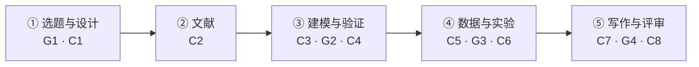

## 王楠 Nan Wang

大连理工大学管理科学与工程博士研究生，2027 年 3 月毕业；2025.06–2026.09 在加拿大 McMaster 大学联合培养。

我研究两类问题：数据分散在多家机构、不能集中时，怎么评估干预效果、怎么协同优化；大模型 Agent 跑长流程时，怎么让产出可控、可查。

**正在找 2027 届岗位**：因果推断 / 策略算法、大模型 Agent 应用、运筹优化算法。 
邮箱：wnan66@mail.dlut.edu.cn

| 方向 | 代表工作 | 规模与结果 |
|---|---|---|
| 因果推断 | 联邦倾向得分匹配、断点回归、因果森林 | 在 eICU 15 万例、207 家医院的数据上验证 |
| 大模型 Agent | MARS 多智能体科研系统 | 29 个 agent、8 个人工检查点、4 个自动质量门 |
| 运筹优化 | 联邦分支定价 | 855 个算例；108 个能求出真最优的算例上平均相差 0.5% |

### 项目

#### 联邦因果推断

多家医院或企业的数据不能出域，仍然要回答“干预有没有用、对谁有用”。下面三个方法都只让各方上传汇总统计量。

- **联邦倾向得分匹配（FPSM）**，估计平均效应。用联邦随机森林估计倾向得分，各方只上传节点上的计数，算出的 Gini 与合并数据上相同；随后完成联邦匹配、平衡性检验和效应估计，并扩展出面板数据版本 FPSM-DID。论文发表于 *Annals of Operations Research*（2025）。
- **联邦因果森林**，估计异质效应。分裂准则只依赖各处理组的样本数、均值和方差，这些量可以由各方的本地统计量精确聚合，所以联邦森林与集中式森林逐棵相同。
  - eICU 多中心数据（150,262 例、207 家医院）上，联邦模型的 R-loss 优于全部 96 家能单独建模的医院。
  - 非独立同分布的模拟设定下，√PEHE 为 0.168；联邦 T-learner 为 0.259，模型平均为 0.700，单机构为 0.732。
  - 分位数分箱、安全聚合、最小计数抑制三项合用，eICU 上重构攻击的个体暴露率从 92.1% 降到 0。
- **联邦断点回归**，支持精确断点和模糊断点。各方只上传核加权的求和统计量，用双双精度求和，联邦估计与合并数据上的估计逐位相同；给定带宽时，与官方 rdrobust 2.1.1 的差小于 1e-10。全流程 10 轮通信，每方上传量与样本量无关。

技术：Python · NumPy · SciPy · scikit-learn

#### MARS 多智能体科研系统

AI 自动写论文，常见的问题是编造文献、数字对不上。MARS 把一个商科研究选题推进到可投稿的 LaTeX 稿件，关键决策留给研究者。运行时是 Claude Code，编排协议和 Python 工具链是我自己写的。

C1–C8 是人工检查点，G1–G4 是自动质量门。评审要求修改时进入修订，改完回到评审。

- **分工**：29 个 agent，其中总控 1 个、执行 18 个、评审 6 个、修订 4 个。每个 agent 是一次性子进程，只读指定文件、只写指定输出。
- **监督**：8 个人工检查点，人可以批准、修改或驳回。4 个自动质量门，失败按诊断结果回退，同一道门回退 3 次就熔断，交给人处理。12 个 JSON Schema 校验每次交接。
- **留痕**：文献来自 Semantic Scholar 实时检索，带调用预算；参考文献逐条对 Crossref 核验；决策和工具调用写入 JSONL 日志，交付包用 SHA-256 清单冻结。
- **规模**：Python 约 1.06 万行（含测试），另有本地 Web 控制台。

技术：Claude Code · Python · JSON Schema · LaTeX

#### 联邦分支定价

几家工厂共同完成一份下料订单，各厂的卷宽和物品宽度不愿交给对方，没法集中建模求解。

- **方法**：Dantzig–Wolfe 分解。协调方广播对偶价格，各厂在本地用动态规划解背包定价子问题，只回传切割方案。整数解由列池上的整数规划给出，三阶段分支作为保隐私的兜底。
- **效果**：855 个算例（合成 270 个、BPPLIB 585 个）。合成算例上，相对 LP 下界的平均 gap 为 1.03%，各厂各自求解为 48.42%。在 108 个能求出真最优的算例上，与最优解平均相差 0.5%，最大 1.2%。
- **通信**：与 consensus ADMM 收敛到相同的 LP 值；合成算例上，通信轮数是它的 1/50 到 1/8。

技术：Python · Gurobi

> 联邦断点回归、MARS、联邦分支定价的代码目前在私有仓库，相关论文发表后公开。面试或合作需要查看，发邮件给我开权限。

### 论文

\* 为通讯作者。

已发表 / 已录用：

1. 【SCI / ABS 3】 Yang Liu, **Nan Wang**\*, Xin Ye. Federated propensity score matching: a method for estimating average treatment effect based on data in islands. *Annals of Operations Research*, 2025. [doi:10.1007/s10479-025-06823-1](https://doi.org/10.1007/s10479-025-06823-1)
2. 【EI / 北大核心 / CSCD】 马大明, 王佳宁, **王楠**\*. 多元处理情景下的异质性处理效应估计方法. *哈尔滨工业大学学报*, 2026（已录用）.
3. 【北大核心 / CSCD】 马大明, **王楠**\*. 考虑载重相关能耗和部分充电的电动车路径优化方法. *公路交通科技*, 2026（已录用）.

在审论文（均为第一作者）：

4. 【UTD24 / FT50 / ABS 4\*】 **Nan Wang**, Elkafi Hassini, Yufei Yuan, Yang Liu. How to Supervise AI Research Agents: A Human-in-the-loop Framework for Quality-Assured Scholarship. *Information Systems Research*.
5. 【ABS 4 / SCI / JCR Q1】 **Nan Wang**, Yang Liu\*, Han Chen, Elkafi Hassini. Federated Sharp Regression Discontinuity: A Privacy-Preserving Causal Inference Across Data Islands. *European Journal of Operational Research*.
6. 【ABS 3 / SCI / JCR Q1】 **Nan Wang**, Yang Liu\*. Federated Causal Forest: Privacy-Preserving Estimation of Heterogeneous Treatment Effects. *Decision Support Systems*.
7. 【SCI / INFORMS 旗下期刊】 **Nan Wang**, Elkafi Hassini, Yang Liu. Federated Branch-and-Price for Knapsack-Based Block-Angular Integer Programs. *INFORMS Journal on Computing*.

### 经历

| 时间 | 学校 | 说明 |
|---|---|---|
| 2022.09–2027.03 | 大连理工大学 经济管理学院 | 管理科学与工程 博士，导师刘洋教授 |
| 2025.06–2026.09 | McMaster University, DeGroote School of Business | 联合培养博士，合作导师 Elkafi Hassini 教授 |
| 2019.09–2022.06 | 大连理工大学 经济管理学院 | 管理科学与工程 硕士 |
| 2015.09–2019.06 | 郑州大学 管理工程学院 | 物流管理 本科，法学双学位 |

- 学术报告：*From Topic to Draft*，McMaster DeGroote 商学院 “AI in Research and Teaching” 工作坊，2026 年 8 月。
- 参与国家自然科学基金面上项目（72171034）和辽宁省自然科学基金项目（2023-MS-100）。

### 技能

- **因果推断**：PSM、DID、RDD、因果森林 / HTE、IPW / AIPW、R-learner 正交化
- **联邦学习与隐私计算**：横向联邦学习、安全聚合、差分隐私
- **运筹优化**：列生成、Branch-and-Price、动态规划、车辆路径问题；Gurobi、cvxpy、Pyomo、OR-Tools、PuLP
- **大模型 Agent**：Claude Code 多智能体编排、agent 规格与提示设计、JSON Schema 结构化输出、LLM-as-a-judge 评测、API 集成
- **编程**：Python（NumPy、pandas、SciPy、scikit-learn、statsmodels）、MATLAB、R、LaTeX

English

 

I am a PhD candidate in Management Science and Engineering at Dalian University of Technology, graduating in March 2027. From June 2025 to September 2026 I was a joint PhD student at McMaster University, DeGroote School of Business.

I work on causal inference and optimization when data are split across institutions that cannot pool their records, and on keeping long-running LLM agent pipelines controllable and auditable. I am looking for 2027 roles in causal inference and decision algorithms, LLM agent applications, and operations research.

- **Federated causal inference.** Propensity score matching (published in *Annals of Operations Research*, 2025); regression discontinuity, sharp and fuzzy, bit-for-bit identical to the pooled estimate; causal forests, tree-for-tree identical to the centralized forest and evaluated on eICU (150,262 patients across 207 hospitals).
- **MARS.** A multi-agent research pipeline on Claude Code: 29 agents, 5 phases, 8 human checkpoints, 4 automatic quality gates, and 12 JSON Schemas that validate every hand-off.
- **Federated branch-and-price.** Multi-factory cutting stock with private factory parameters. 855 instances; within 1.2% of the true optimum on all 108 instances where it is known (mean 0.5%).

Code for the unpublished projects is in private repositories. Access is available on request: wnan66@mail.dlut.edu.cn

